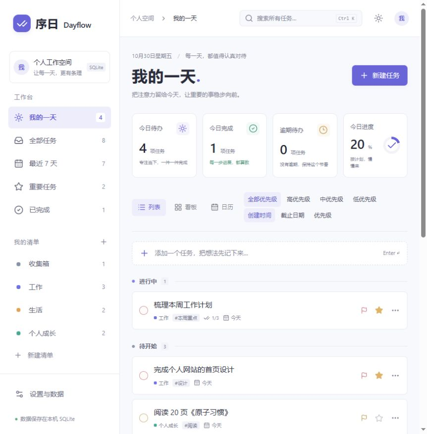
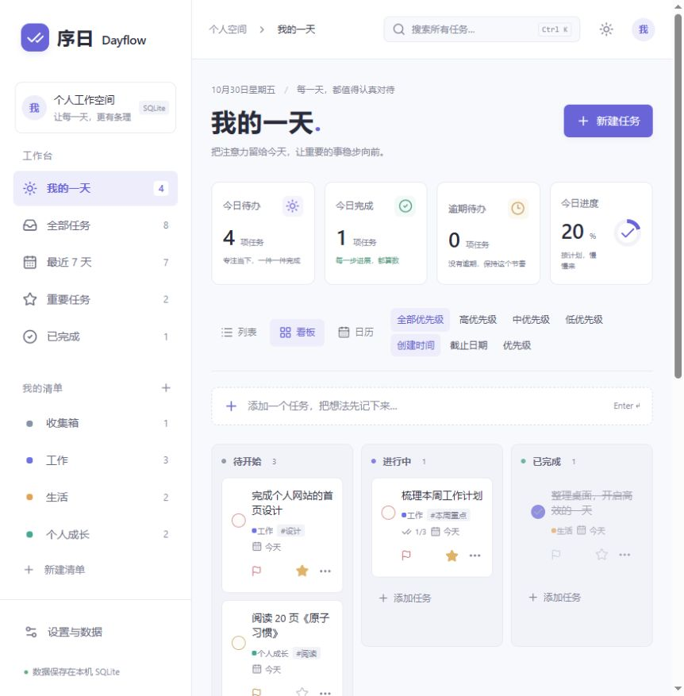
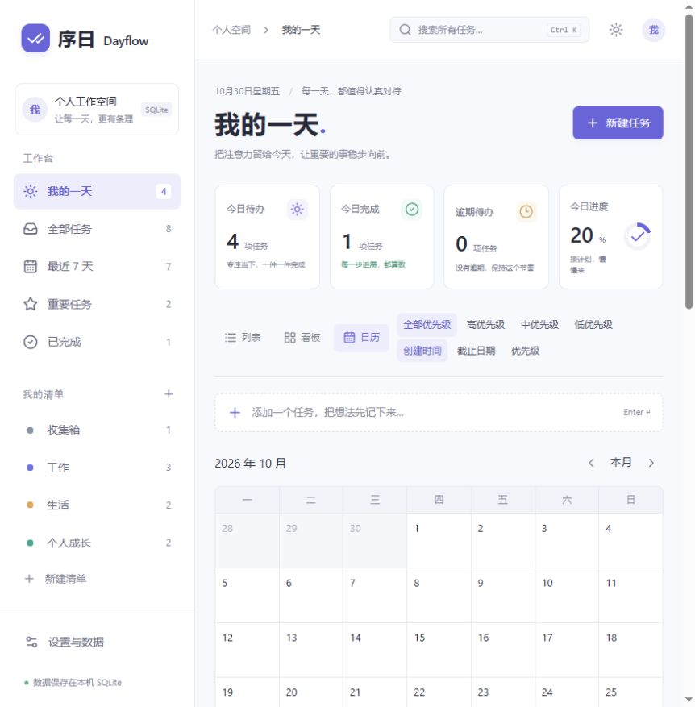

# 序日 Dayflow

个人任务管理工具，支持列表、看板、日历和专注计时。使用 SQLite 单文件存储，可在本地或服务器上运行。

## 功能

- 列表、看板、日历三种视图，支持拖动调整任务状态。
- 截止日期、优先级、标签、备注、子任务和重要标记。
- 自定义清单，按日期、状态和优先级筛选，支持搜索和排序。
- 专注计时，支持 15、25、45、60 分钟。
- JSON 备份导入与导出。
- 浅色和深色主题。

## 界面预览

### 列表



### 看板



### 日历



## 快速开始

环境要求：**Node.js ≥ 22.12.0**、npm。无需单独安装数据库。

```bash
git clone https://github.com/why-qw1ko/taskManage.git
cd taskManage
npm ci
npm run dev
```

默认访问地址：`http://localhost:3000`，以终端输出为准。首次运行会自动建库并载入示例任务，可在「设置与数据」中清除示例。

## 部署

在项目根目录执行：

```bash
npm run build
npm start
```

默认监听 `127.0.0.1:3000`，端口可通过 `PORT` 环境变量修改。运行时需要保留 `dist/`、`node_modules/` 和 `migrations/`。

应用没有登录和多用户隔离，所有访问者共用一份数据。公网部署需在入口配置访问认证。

### IP 访问

在项目根目录创建 `.env.production`，填写实际访问地址：

```dotenv
DAYFLOW_ALLOWED_ORIGINS=http://192.168.1.50:3000
```

地址包含协议、IP 或域名及端口，不含页面路径。多个地址用英文逗号分隔，不支持通配符。修改后重启服务；开发环境使用 `.env.local`。

内网直接访问时，使用以下命令监听网卡：

```bash
node --experimental-sqlite node_modules/vinext/dist/cli.js start --hostname 0.0.0.0
```

### 域名与 HTTPS

`.env.production` 配置示例：

```dotenv
DAYFLOW_ALLOWED_ORIGINS=https://dayflow.example.com
VINEXT_TRUSTED_HOSTS=dayflow.example.com
```

在 Nginx 已配置 HTTPS 的站点中添加：

```nginx
location / {
    proxy_pass http://127.0.0.1:3000;
    proxy_set_header Host $http_host;
    proxy_set_header X-Forwarded-Host $http_host;
    proxy_set_header X-Forwarded-Proto $scheme;
}
```

替换示例域名，使用 `npm start` 启动服务。`VINEXT_TRUSTED_HOSTS` 不含协议，使用非默认端口时需带上端口。

`/api/data` 返回 403 时，检查访问地址白名单及代理转发的域名、协议是否匹配。

## 数据与备份

默认数据库文件为 `.dayflow-data/dayflow.sqlite`，保存任务、清单和设置。可通过 `DAYFLOW_DB_PATH` 修改路径；相对路径以项目根目录为基准，所在目录需可写。

- **JSON 备份**：在「设置与数据」中导出或导入。导入采用合并方式，同 ID 的已有任务保留，文件上限为 5 MB。
- **数据库备份**：停止服务后复制数据库文件，恢复时也需停止服务。写入期间可能短暂生成 `-journal` 文件。
- **数据目录**：`.dayflow-data/` 已被 Git 忽略，更新或迁移项目时需单独保留。

## 快捷键

| 快捷键 | 操作 |
| --- | --- |
| `N` | 新建任务，输入框内不触发 |
| `Ctrl+K` / `⌘+K` | 搜索任务 |

## 开发

技术栈：React、TypeScript、Vinext、Vite、Tailwind CSS、Base UI、SQLite。

```bash
npm test
npx tsc --noEmit --incremental false
npm run lint
```

格式化：`npm run format`。

问题反馈：[Issues](https://github.com/why-qw1ko/taskManage/issues)。欢迎提交 PR。

## 许可证

本项目采用 [MIT 许可证](LICENSE)。
